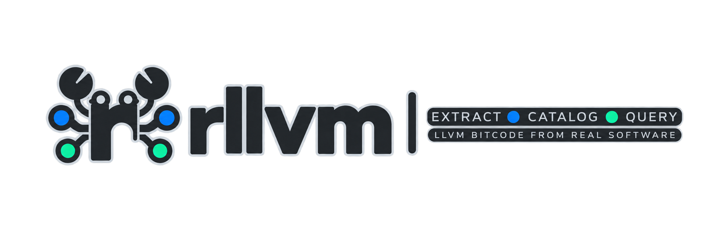
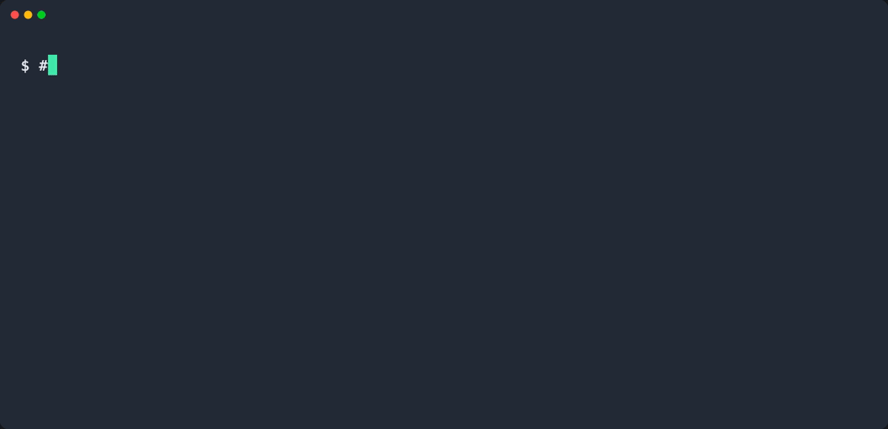
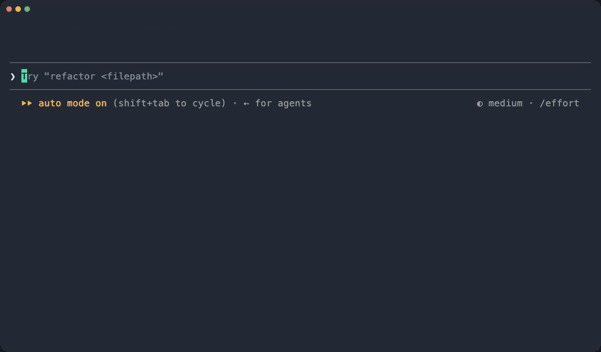
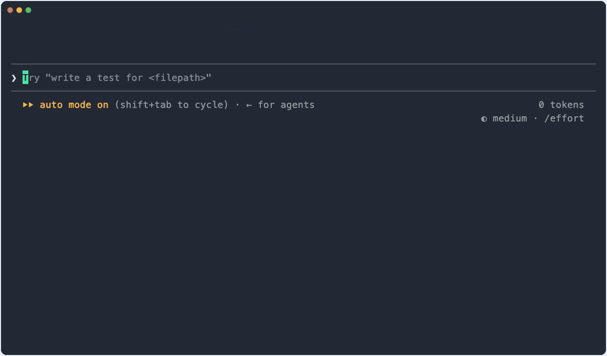

# rllvm



[](https://github.com/h1994st/rllvm/actions/workflows/ci.yml)
[](https://codecov.io/github/h1994st/rllvm)
[](https://crates.io/crates/rllvm)

Extract whole-program LLVM bitcode from any build.

Point your build system at rllvm's compiler wrappers, build normally, then pull
the bitcode for the whole program back out of the finished binary, and ask it
source-level questions across C, C++ and Rust.

## Coming from wllvm or gllvm?

rllvm keeps the `CC`/`CXX` → build → extract workflow of
[wllvm](https://github.com/travitch/whole-program-llvm) and
[gllvm](https://github.com/SRI-CSL/gllvm): `rllvm-cc` and `rllvm-cxx` stand in
for `wllvm`/`gclang`, `rllvm-get-bc` for `extract-bc`/`get-bc`.

| | 🌟 rllvm | wllvm / gllvm |
| --- | --- | --- |
| 🦀 Languages | [C, C++, Objective-C, **Rust**](#capturing-bitcode) | C, C++, Fortran |
| 🔍 Analysis | [Source-level queries, MCP server](#analyzing-bitcode) | ❌ |
| 🤖 Agents | [Claude Code plugin](#claude-code-plugin) | ❌ |
| 📋 No wrapper build | [Import `compile_commands.json`](examples/compdb/) | ❌ |
| 🎯 Targets | [Native, cross, **WebAssembly, eBPF**](#capturing-bitcode) | Native; cross with a target `objcopy` |
| 🔗 LTO | [Three modes, dispatched on object content](examples/lto/) | `-flto` unlikely to survive extraction |
| ♻️ Rebuilds | Cache validated against inputs | No bitcode cache |
| 📦 Moving a build tree | [Paths relative to a root](examples/relocatable/) | Absolute bitcode paths |
| ⚙️ Setup | [Detected from `llvm-config`](#configuration) | Environment variables |

## Quick start

```bash
brew install h1994st/tap/rllvm llvm   # macOS or Linux with Homebrew
# Or: cargo install rllvm
# LLVM on Ubuntu/Debian: sudo apt install llvm llvm-dev clang libclang-dev
```

```bash
rllvm-cc hello.c -o hello
rllvm-get-bc hello       # writes hello.bc
rllvm-info hello.bc      # target, function, block, instruction counts
```

On first run, tool paths are detected from `llvm-config` and written to
`~/.rllvm/config.toml`.



## How it works

<picture>
  <source media="(prefers-color-scheme: dark)" srcset="docs/assets/architecture-dark.svg">
  
</picture>

The wrappers run the real compiler and also emit bitcode. Each object gets a
section recording its bitcode path; the linker concatenates those sections, so
the binary lists every module that went into it. Extraction reads the paths
back and merges the modules.

Capture covers only what you build through the wrappers. A prebuilt native
library contributes no bitcode, so build every dependency you need in the
whole-program view.

## Claude Code plugin



```text
/plugin marketplace add h1994st/rllvm
/plugin install rllvm@rllvm
```

| Part | What it does |
| --- | --- |
| `setup` skill | Installs `rllvm` and `rllvm-query` with your approval, picks a compatible LLVM, configures, and troubleshoots |
| `capture` skill | Chooses how to capture your build and what to extract |
| `query` skill | Picks the query that answers your question and reports what the answer does not cover |
| `complete-callgraph` skill | Resolves unresolved indirect calls into a labeled overlay, never reported as proven |
| `/overlay-view` | A read-only pane of the overlay's candidates and edges |
| MCP server | `rllvm-query mcp`, configured automatically |

Builds run as ordinary shell commands you approve, never inside the server.
See the [plugin example](examples/claude-plugin/).

## Capturing bitcode

```bash
CC=rllvm-cc CXX=rllvm-cxx ./configure && make             # Autotools, Make
CC=rllvm-cc CXX=rllvm-cxx cmake -S . -B build && cmake --build build
RUSTC_WRAPPER=rllvm-rustc cargo build                     # Rust and its C/C++
rllvm-compdb generate build/ --output-dir analysis/all    # compile_commands.json
```

`rllvm-cc` wraps `clang` and `rllvm-cxx` wraps `clang++`, Objective-C included.
`rllvm-compdb` compiles an existing compilation database without rebuilding,
so its modules describe the source tree rather than a real link.

| Build | Notes | Example |
| --- | --- | --- |
| CMake, Objective-C | Toolchain file `cmake/rllvm-toolchain.cmake` sets all four compilers | [cmake](examples/cmake/), [objc](examples/objc/) |
| Rust | Per-crate capture; your LLVM must read what `rustc -vV` emits | [rust](examples/rust/), [ffi](examples/ffi/) |
| LLD | `-fuse-ld=lld` | [lld](examples/lld/) |
| LTO | `RLLVM_LTO_MODE`: `marker` (default), `save-temps` or `skip` | [lto](examples/lto/) |
| Cross | `--target=<triple>` reaches the compile and the link | [cross-compile](examples/cross-compile/) |
| WebAssembly, eBPF | `--target=wasm32-unknown-unknown`, `--target=bpf -g` | [wasm](examples/wasm/), [ebpf](examples/ebpf/) |
| Compilation database | Direct `clang`/`clang++` entries; select with `--source` or `--entry` | [compdb](examples/compdb/) |

Every compiler flag reaches the real compiler. Wrapper options are long-only and
prefixed `--rllvm-`, such as `--rllvm-verbose=3` to log subcommands; see the
[wrapper options example](examples/wrapper-options/). `RLLVM_CACHE=1` skips the
extra bitcode compilation on a rebuild once the preprocessed inputs,
dependencies, compiler, command, directory and environment match; keep it off
when inputs preprocessing cannot see, such as profiles, change. Universal (multiple
`-arch`) builds are unsupported.

## Extracting bitcode

```bash
rllvm-get-bc app                         # one whole-program app.bc
rllvm-get-bc -b libfoo.a                 # a bitcode archive, libfoo.bca
rllvm-info app --json > catalog.json     # which modules, and where they came from
rllvm-get-bc app --module MODULE_ID --output-dir analysis/selected
```

`rllvm-get-bc` accepts executables, objects and archives. A catalog records the
modules found and their provenance; queries read it, and `--module`, `--source`
and `--configuration` select from it. To move a build tree, build with
`RLLVM_BITCODE_ROOT` and extract with `--bitcode-root`.

See the [merge strategies](examples/merge-strategies/),
[catalogs](examples/catalogs/) and [relocatable](examples/relocatable/)
examples, and the [catalog format](docs/CATALOG.md).

## Analyzing bitcode

`rllvm-query` links LLVM statically, so it ships separately:

```bash
brew install h1994st/tap/rllvm-query   # brings its own llvm
# Or: cargo install rllvm-query
# If llvm-config is not on PATH: LLVM_SYS_231_PREFIX="$(brew --prefix llvm)"
```

On Ubuntu/Debian, install `libpolly-N-dev` alongside `llvm-N-dev` and
`libclang-N-dev`.

```bash
rllvm-query --catalog catalog.json defs parse_frame            # where it is defined
rllvm-query --catalog catalog.json at parser.c 4               # what is at a source line
rllvm-query --catalog catalog.json callers parse_frame         # who calls it
rllvm-query --catalog catalog.json callees main                # what it calls
rllvm-query --catalog catalog.json uses parse_frame            # where its address is taken
rllvm-query --catalog catalog.json reach main parse_frame      # a path between two functions
rllvm-query --catalog catalog.json slice main parse_frame      # every function on such a path
rllvm-query --catalog catalog.json closure parse_frame in      # everything that reaches it
rllvm-query --catalog catalog.json externals                   # unbound symbols
rllvm-query --catalog catalog.json ffi-exports                 # Rust functions C can call
rllvm-query --catalog catalog.json indirect-targets parser.c:8 # targets of an indirect call
rllvm-query --catalog catalog.json resolution-candidates       # unresolved indirect calls
rllvm-query --catalog catalog.json guards --at clamp.c:14 --operand 2  # what bounds a value
```

Every answer also says what it could not see: modules that failed to parse,
indirect call sites, ambiguous bindings, and source that changed since it was
compiled. Add `--json` for the machine-readable envelope or `--full` for those
blocks as text. Name a symbol by its mangled name, its demangled reading, or a
bare identifier that searches. A `file:line` names its file as the debug info
recorded it, or by any path to the same file, symlinks included. Pipe several
queries in, one per line, to load the catalog once. Extracted facts are cached;
`RLLVM_QUERY_CACHE=0` turns that off, and `rllvm-query cache clear` empties it.

See the [queries](examples/queries/), [name resolution](examples/name-resolution/)
and [staleness](examples/staleness/) examples.

### Completing the call graph

<picture>
  <source media="(prefers-color-scheme: dark)" srcset="docs/assets/callgraph-dark.svg">
  
</picture>

An agent that resolves an indirect call records it with `rllvm-query overlay
record` in an overlay file beside the catalog (or `--overlay PATH`); the catalog
itself never changes. Overlay edges are hypotheses: `reach`, `closure` and
`slice` walk them only with `--include-overlay` (and `--min-confidence`), label
each step `agent`, and never call such a path proven. `slice --emit-module
OUT.bc` writes a slice as one small module for checking an edge. An overlay can
also hold `annotate` verdicts on whether a value is feasible, which `reach` and
`slice` surface with `--annotations`. See the
[call-graph overlay example](examples/callgraph-overlay/).



### Value guards

`guards` lists the comparisons, clamps, masks and moduli that constrain a
call's argument (`--at FILE:LINE --operand N`), its result (`--return`) or a
`-g` local (`--function F --local NAME`), with each guard's bound and source
line; `--from F` keeps only callers on a path from `F`. A local reused for
several values is refused with the lines that use it; `--at FILE:LINE` beside
`--local` traces the value it holds at that use. A use at a line is a read of
the value the local holds there, possibly through another variable that holds
the same value. An overlay `annotate` anchor carries no use-site, so a reused
local cannot be annotated.
Each guard gives `affine`, `anchored = scale * guarded + offset`, when its
relation to the value is a constant one. `verified` means its bound soundly
carries to the value; otherwise it is a lead whose `caveat` says why: the
relation is not affine, the guard bounds a value computed from it, the bound
wraps, or it cannot be mapped. A clamp computed from the value bounds its own
result, so the comparison it is made of is listed too: that one bounds the
value, verified only on its branch's edge into the use. `verified` does not say
the guard runs on every path, `relation` does: an unconditional bound is
`verified` and `dominates` or `defines`, while one `on_path` is conditional.
The numeric cap is `bound`: a `verified` guard without one is capped by a
runtime value, the guard's operand, which is a sound relation but not a numeric
limit; to reach a number, anchor on that operand and trace it.
A load is followed to the nearest store before it in its block, which
overwrites any earlier one, with nothing between that writes memory. A call,
another store or any other operation between (an `atomicrmw`, a `cmpxchg`, a
volatile load), or stores only in other blocks, make each guard reached
through it a lead, and the trace is reported lost there.
It is evidence, never a verdict: an empty list does not mean unbounded. See the
[value guards example](examples/value-guards/).

### MCP server

`rllvm-query mcp` serves the same queries as tools over stdio:

```json
{ "mcpServers": { "rllvm": { "command": "rllvm-query", "args": ["mcp"] } } }
```

A client loads a catalog with `load_catalog` or a binary with `inventory`, and
keeps several loaded at once. See the [MCP example](examples/mcp/); the
[Claude Code plugin](#claude-code-plugin) configures this for you.

## Configuration

The TOML file lives at `$RLLVM_CONFIG` or `~/.rllvm/config.toml`.
`rllvm-init --dry-run` previews detection; `--llvm-prefix` chooses a toolchain
and `-o` selects the file to write.

<details markdown="1">
<summary>Configuration keys</summary>

| Key | Required | Description |
| --- | --- | --- |
| `llvm_config_filepath` | Yes | Absolute path to `llvm-config` |
| `clang_filepath` | Yes | Absolute path to `clang` |
| `clangxx_filepath` | Yes | Absolute path to `clang++` |
| `llvm_ar_filepath` | Yes | Absolute path to `llvm-ar` |
| `llvm_link_filepath` | Yes | Absolute path to `llvm-link` |
| `llvm_objcopy_filepath` | No | Absolute path to `llvm-objcopy`; preferred for embedding, with an internal fallback |
| `llvm_bindir` | No | Directory of the LLVM tools without a key of their own (`llvm-nm`, `llvm-dis`, `llvm-extract`, `opt`; default: `llvm-config --bindir`) |
| `rustc_filepath` | No | Compiler for direct Rust invocation; `RLLVM_REAL_RUSTC` overrides; defaults to `rustc` on `PATH` |
| `bitcode_store_path` | No | Directory for bitcode files (must be absolute; created if missing) |
| `bitcode_root` | No | Record embedded paths relative to this root (default: absolute) |
| `llvm_link_flags` | No | Extra flags for `llvm-link` |
| `lto_ldflags` | No | Extra flags for link-time optimization |
| `bitcode_generation_flags` | No | Extra flags for bitcode generation (e.g. `-flto`) |
| `lto_mode` | No | How `-flto` builds record bitcode: `marker` (default), `save-temps`, `skip`; `RLLVM_LTO_MODE` overrides |
| `is_configure_only` | No | Skip extra C/C++ bitcode work (default: `false`) |
| `cache_enabled` | No | Reuse C/C++ bitcode across rebuilds; overridden by `RLLVM_CACHE` (default: `false`) |
| `cache_dir` | No | Cache directory; also holds rllvm-query's `query-facts/` (default: `~/.rllvm/cache`) |
| `query_cache` | No | Reuse rllvm-query's extracted per-module facts; overridden by `RLLVM_QUERY_CACHE` (default: `true`) |
| `query_cache_warn_mb` | No | Facts cache size, in MB, past which rllvm-query warns (default: `1024`) |
| `log_level` | No | 0=error (default), 1=warn, 2=info, 3=debug, 4+=trace; `RLLVM_LOG_LEVEL` overrides |

</details>

## Benchmarks

Clean build-only time relative to native compilation, on an Apple M4 with
LLVM 23.1.2:

| Workload | Cache disabled | Primed C/C++ cache |
|---|---:|---:|
| nghttp2 C (CMake) | 1.86× | 1.65× |
| nghttp2 C++ (CMake) | 1.88× | 1.28× |
| Quiche (Cargo) | 1.28× | 1.23× |

C/C++ capture adds a bitcode compilation per source; Rust emits bitcode in the
same rustc invocation.

See the [baseline](benchmarks/baselines/2026-10-03-apple-m4/README.md) for
conditions and the [benchmark guide](benchmarks/README.md) for reproduction.

## Related projects

[wllvm](https://github.com/travitch/whole-program-llvm) and
[gllvm](https://github.com/SRI-CSL/gllvm) built the wrapper-and-extract approach
this tool follows.

[rules_rllvm](https://github.com/h1994st/rules_rllvm) is a separate Bazel-native
project and does not use these binaries.

## License

[Apache-2.0](LICENSE)
